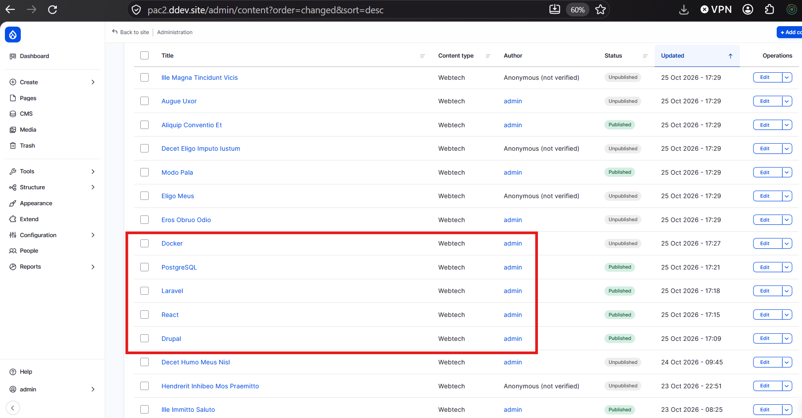
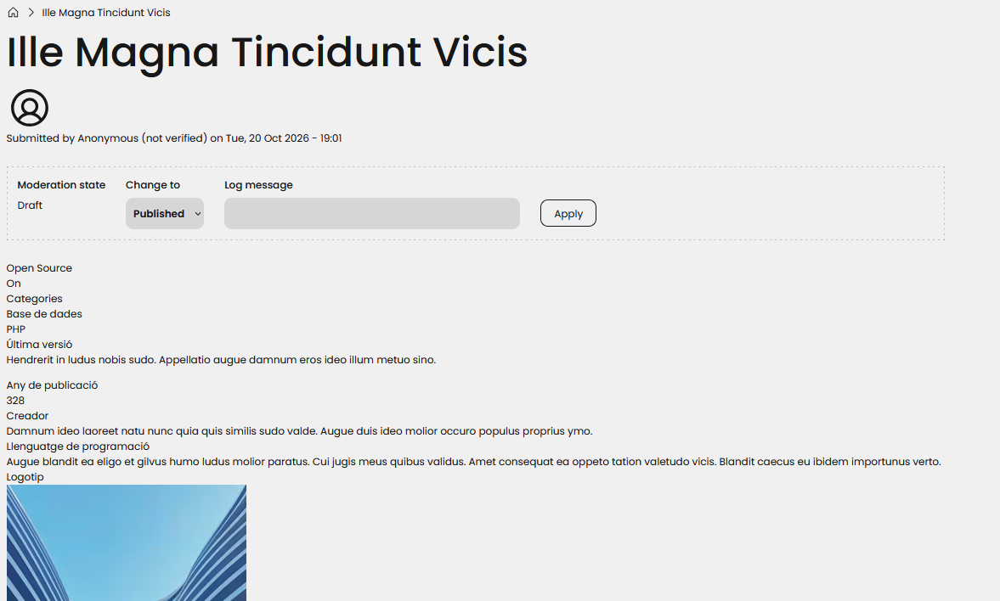
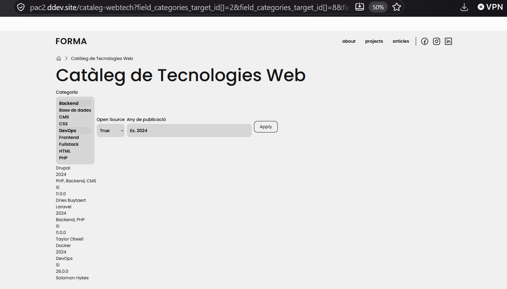

<link rel="stylesheet" type="text/css" href="styles.css">

<div style="text-align: center; padding-top: 80px; padding-bottom: 50px;">

# PAC 2 - implementació d'una web en Drupal 10/11 <!-- omit in toc -->
## Desenvolupament back-end (UOC) <!-- omit in toc -->
<br>

### **Nom i Cognoms:** Àlex Cordón Vila <!-- omit in toc -->
### **Professor:** Daniel Julià Lundgren <!-- omit in toc -->
### **Data:** 11 de Novembre de 2026 <!-- omit in toc -->

</div>

---
>Cal explicar detalladament com s'ha realitzat l'activitat, incloent-hi els errors trobats (si n'hi hagués) i les solucions aplicades. 
>Es poden incloure captures de pantalla per il·lustrar el procés.
>L'extensió màxima permesa és 1 pàgina per tasca. No s'estableixen restriccions de format (interlineat, mida de font, etc.), però l'incompliment del límit d'extensió serà penalitzat.
--- 


<div style="page-break-after: always;"></div>

## Índex <!-- omit in toc -->
- [Activitat 1. Instal·lació de Drupal](#activitat-1-installació-de-drupal)
- [Activitat 2. Creació de continguts](#activitat-2-creació-de-continguts)
- [Activitat 3. Catàleg filtrable](#activitat-3-catàleg-filtrable)
- [Activitat 4. Catàleg filtrable](#activitat-4-catàleg-filtrable)
  - [1. Disseny i maquetació de la fitxa de contingut](#1-disseny-i-maquetació-de-la-fitxa-de-contingut)
  - [2. Bloc de "Tres tecnologies web similars" (R4)](#2-bloc-de-tres-tecnologies-web-similars-r4)
+


<div style="page-break-after: always;"></div>


## Activitat 1. Instal·lació de Drupal 
Per instal·lar Drupal CMS amb DDEV hem seguit la documentació [Drupal CMS User Guide - Install with DDEV](https://project.pages.drupalcode.org/drupal_cms/get-started/ddev/).
En primer lloc s'ha creat un nou directori de projecte Drupal dins l'entorn Linux amb la següent comanda:

```bash
cd ~/projectes
mkdir ~/projectes/pac2 && cd ~/projectes/pac2
```

Un cop creada la carpeta podem usar Composer per crear el projecte de Drupal 11 amb el següent codi:

```bash
cd ~/projectes/pac2
ddev config --project-type=drupal11 --docroot=web
ddev composer create-project drupal/cms
```

Això descarrega els fitxers necessaris i configura l'entorn del CMS Drupal.

> **Nota:** Abans d'executar el bloc de codi anterior cal que tinguem en compte que, en el nostre cas, hem de tenir Docker Desktop executant-se a Windows.


Per comprobar que tot ha anat bé podem usar ``ddev drush status`` i ``ddev drush status-report`` :

```bash
Drupal version   : 11.4.10                                    
Site URI         : https://pac2.ddev.site                     
DB driver        : mysql                                      
DB hostname      : db                                         
DB port          : 3306                                       
DB username      : db                                         
DB name          : db                                         
Database         : Connected                                  
Drupal bootstrap : Successful                                 
Default theme    : forma_theme                                
Admin theme      : gin                                        
PHP binary       : /usr/bin/php8.4                            
PHP config       : /etc/php/8.4/cli/php.ini                   
PHP OS           : Linux                                      
PHP version      : 8.4.24                                     
Drush script     : /var/www/html/vendor/bin/drush.php         
Drush version    : 13.8.0.0                                   
Drush temp       : /tmp                                       
Drush configs    : /var/www/html/vendor/drush/drush/drush.yml 
Install profile  :                                            
Drupal root      : /var/www/html/web                          
Site path        : sites/default                              
Files, Public    : sites/default/files                        
Files, Temp      : /tmp                                       
Drupal config    : sites/default/files/sync     

```

Finalment, un cop verificat que tot ha anat bé, podem anar a la configuració de Drupal des del navegador. 
Per obrir l'entorn web cal executar el següent bloc:

```bash
ddev start
ddev launch
```


> **Nota:** Per arrencar el projecte cada vegada cal seguir aquests passos:
> 1. Obrir Docker Desktop
> 2. Anar a la terminal de Linux amb `wsl -d DDEV` i entrar a la carpeta `cd ~/projectes/pac2`
> 3. Executar `ddev start` i `ddev launch`
> 4. Com a usuari administrador hem posat: **acordonv@uoc.edu**
> 5. Coma password hem usat: **Pepa123!**

Les URL que cal que tinguem en compte son les següents:
  1.  Project Url: https://pac2.ddev.site 
  2.  http: 127.0.0.1:51698
  3.  https: 127.0.0.1:51699
  4.  mailpit (mail de test): https://pac2.ddev.site:8026 o 127.0.0.1:51697
  5.  db: 127.0.0.1:51700
  6.  phpmyadmin: https://pac2.ddev.site:8037 

<div style="page-break-after: always;"></div>

## Activitat 2. Creació de continguts

L'objectiu principal d'aquest punt és generar contingut seguint una estructura determinada. Per fe-ho cal tenir present que a Drupal podem definir estructures anomenades Tipus de contingut personalitzat. Per crear aquest contingut hem anat a ``admin/structure/types`` i allà hem fet click a **Add content type** i l'hem anomenat Webtech.


L'estructura creada és la seguent:
```bash
Title -> Tipus: String (Short text)
Open Source -> Tipus: Boolean
Categories -> Tipus: Entity reference > Taxonomy term,  Vocabulari: Categories
Última versió -> Tipus: Text plain
Any de publicació darrera versió -> Tipus: Number integer
Creador -> Tipus: Text plain
Llenguatge de programació -> Tipus: Text plain
Logotip -> Tipus: Image
```
>Nota: Per crear la taxonomia del camp de Categories hem creat previament la taxonomia de Categories creant el vocabulari nou. La taxonomia és el sistema d'organització i classificació per etiquetes que ens permet agrupar continguts que tenen coses en comú. Hem anat a ``admin/structure/taxonomy``, hem creat una Categoria Webtech i hem afegit aquests termes: Frontend, Backend, Fullstack, HTML, CSS, PHP, CMS, DevOps, Base de dades.  

Un cop tenim definit el tipus de contingut propi hem pogut crear manualment les 5 tecnologies reals. Per crear el contigut fictici s'ha usat el mòdul de Drupal anomenat ``Devel`` que previament s'ha instalat amb Composer. Per crear aquest contingut cal anar a ``/admin/config/development/generate/content`` i seleccionar el tipus de contigut Webtech.


Si anem a ``admin/content`` podrem veure la llista de Content creat manualment (recuadre vermell) i la resta creat amb Devel:



Usant Devel hem trobat un error per no haver configurat correctament els camps del tipus de contingut. Aquest és un exemple de la primera prova de generació de contingut on podem veure que els camps que s'han omplert no tenen el format esperat:



Per millorar-ho hem afegit les labels al camp de "Open Source" amb Si/No. En els camps de "Última versió", "Creador" i "Llenguatge de programació" ha generat paràgrafs llargs de text Lorem Ipsum així que hem reduit els caracters acceptats en aquests camps.
<div style="page-break-after: always;"></div>

## Activitat 3. Catàleg filtrable 

L'objectiu d'aquest exercici és crear una pàgina amb un catàleg per al tipus de contingut Webtech que permeti filtrar les tecnologíes per Categoria, Open Source i Any de publicació de la darrera versió.

Per fer-ho hem usar el modul de Vista anant a ``Structure > Views`` i hem afegit una nova Vista que hem anomenat Cataleg Webtech. 
Per a configurar la vista hem afegit els seguents punts:
  1. **Format**: Unordered list mostrant **Fields**.
  2. **Camps (Fields)**: Títol, Categories, Open Souce, Any de publicació, creador.
  3. **Filtres Exposats**: 
     - **Categoria**: De tipus taxonomia i exposat amb operador "Is one of", amb Reduce duplicates per evitar entrades duplicades i amb valor per defecte "Any" per poder veure tot el cataleg inicialment.
     - **Open Source**: De tipus booleà amb operador "is equal to" i amb valor per defecte "Any" per poder veure tot el cataleg inicialment.
     - **Any de publicació**: De tipus enter i exposat amb operador "Is equal to", valor per defecte buit i un placeholder amb un exemple "Ex: 2024".

Un cop hem configurat cada filtre podem veure el cataleg a aquesta url: ``https://pac2.ddev.site/cataleg-webtech``



## Activitat 4. Catàleg filtrable 

### 1. Disseny i maquetació de la fitxa de contingut
- **Estructura en columnes:** S'ha activat el mòdul **Layout Builder** al tipus de contingut *Webtech* per organitzar la informació en una disposició de dues columnes.
- **Optimització visual:**
  - Columna esquerra: Ajust de la mida del logotip (formatador *Medium*) i visualització de les categories.
  - Columna dreta: Disposició dels camps en línia (*Inline*) per a metadades com *Open Source*, *Última versió*, *Any de publicació*, *Creador* i *Llenguatge de programació*.
- **Neteja d'interfície:** S'han amagat les etiquetes redundants (com el nom del logotip) i s'ha desactivat la informació d'autor i data de publicació des de la configuració del tipus de contingut.

### 2. Bloc de "Tres tecnologies web similars" (R4)
Per afegir la secció de les 3 tecnologies similars hem creat una vista de nom ``Tecnologies similars`` amb el check de "Create a block" seleccionat. Per als View Settings hem seleccionat ``Show Content of type Webtech sorted by Title``. Per a configurar el block hem introduit un titol ``Tecnologies similars`` i ``Display format Unformated list output as fields``. 

- **Filtres contextuals (Contextual Filters):**
  1. **Exclusió del node actual:** S'ha configurat un filtre per `Content: ID` que obté l'ID de la URL i l'exclou (`Exclude`), evitant que la tecnologia que s'està consultant es recomani a si mateixa.
  2. **Coincidència per Categoria:** S'ha afegit el filtre `Has taxonomy term ID` configurat per carregar els termes des de la pàgina del node (`Load default filter from node page`) i filtrar continguts que comparteixin qualsevol categoria (`Filter to items that share any term`).
- **Integració:** S'ha afegit el bloc directament a la part inferior de la plantilla de maquetació de *Layout Builder*.

Podem veure el resultat final en aquesta captura:


